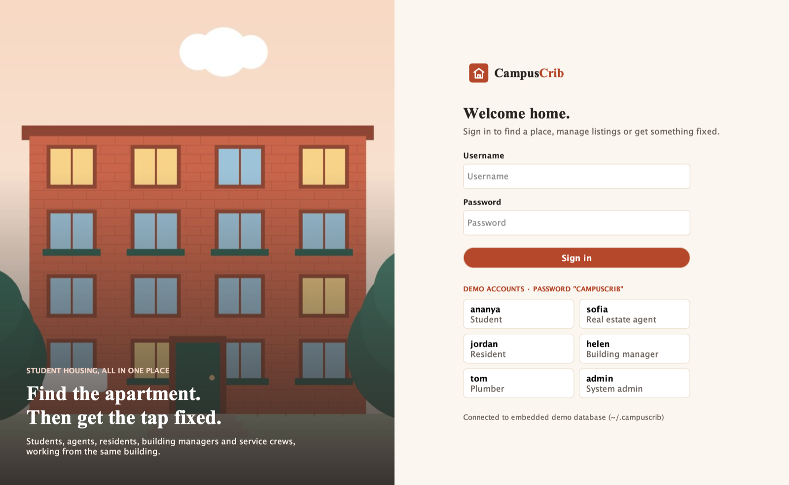
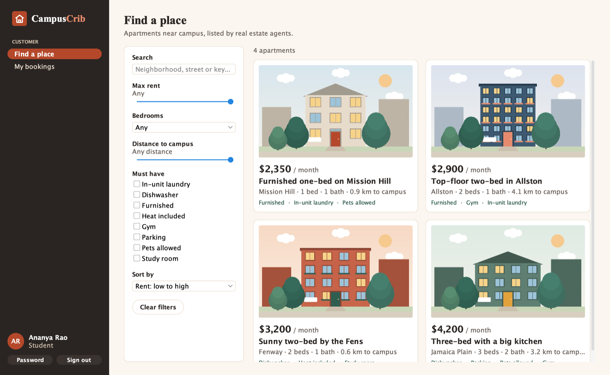
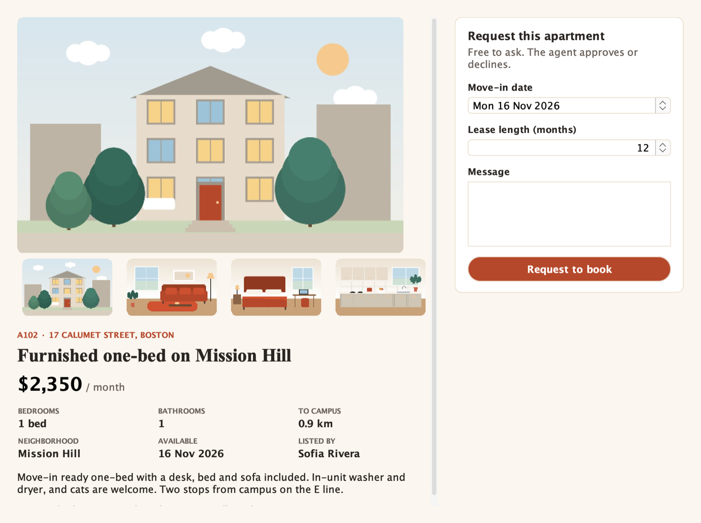
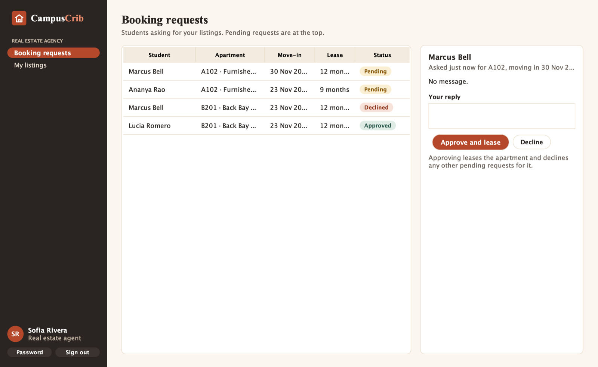
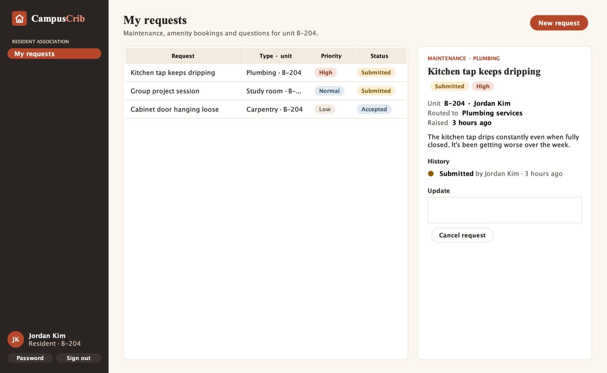
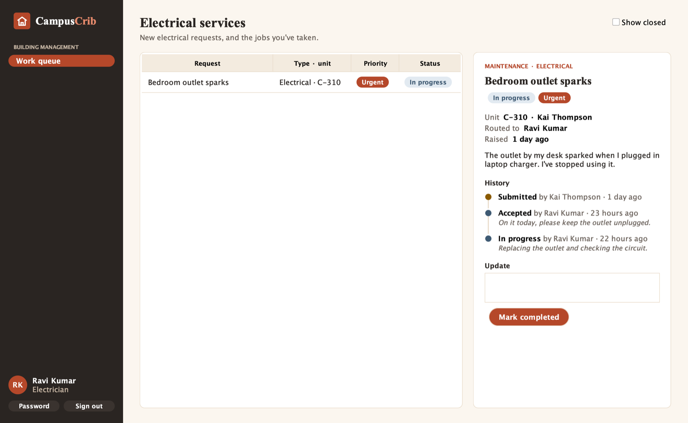
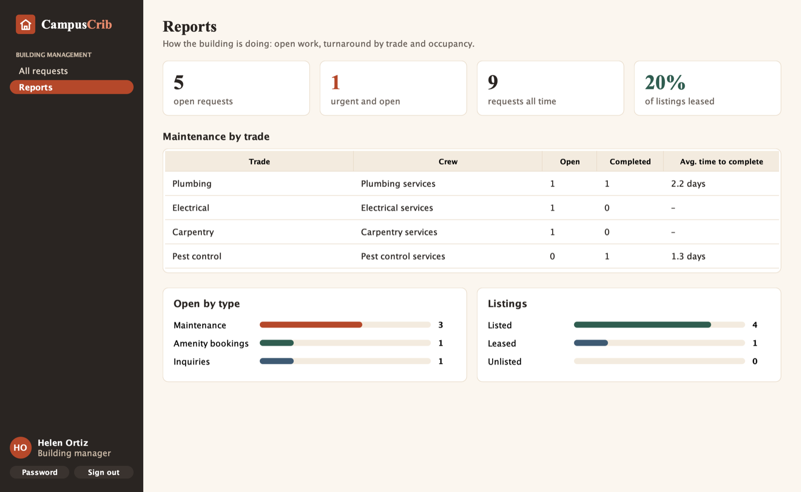

# CampusCrib

**Student housing, all in one place: find the apartment, then get the tap fixed.**

CampusCrib is a Java desktop app for the whole student-housing journey. Students search and request apartments, real estate agents approve bookings, residents raise maintenance and amenity requests, and each request is routed to the right service crew or to building management, with its full history recorded.



> Originally built in 2024 by **Group 60, Aditya Hasija, Aravind Ravi and Nidhi Nair**, as a team project modelled as a network of enterprises, organizations and roles ([presentation](docs/archive/campus-crib-presentation.pdf)). **v2** rebuilds it so every role works end to end, with real persistence, security and tests. See [CHANGELOG.md](CHANGELOG.md).

## Who does what

CampusCrib follows the team's original design: one network, four enterprises, and the organizations and roles inside them.

| Enterprise | Role | In the app |
| --- | --- | --- |
| Customer | **Student** | Search apartments (rent, bedrooms, distance, must-have amenities), view photos, request a booking, track replies |
| Real Estate Agency | **Real estate agent** | Create and edit listings with photos, list or unlist them, approve or decline booking requests |
| Resident Association | **Resident** | Raise maintenance requests, book shared spaces, ask building management questions, follow each request's history |
| Building Management | **Building manager** | See every request, assign maintenance to a crew member, approve amenity bookings, answer inquiries, read reports |
| Building Management | **Plumber, electrician, carpenter, pest control** | A work queue for their trade only: accept a job, start it, complete it with a note |
| CampusCrib Network | **System admin** | Manage everyone's accounts, roles and access |

**Routing.** Maintenance goes to the crew for its trade; amenity bookings and inquiries go to building management. Each change is recorded as an event (who, from what, to what, and the note), so residents always see where things stand.

| | |
| --- | --- |
|  |  |
|  |  |
|  |  |

## Run it

You need **Java 17 or newer**. Nothing else: by default CampusCrib uses an embedded demo database in `~/.campuscrib`, loaded with demo data on first launch.

```bash
git clone https://github.com/AdityaHasija37/CampusCrib.git
cd CampusCrib
./mvnw package
java -jar target/campuscrib.jar
```

On Windows use `mvnw.cmd package`. To start the demo again from scratch: `java -jar target/campuscrib.jar --reset-demo`.

**Demo accounts** (all use the password `campuscrib`; the sign-in screen fills them in for you):

| Username | Role |
| --- | --- |
| `ananya`, `marcus`, `lucia` | Students |
| `sofia`, `daniel` | Real estate agents |
| `jordan`, `kai`, `amara` | Residents (units B-204, C-310, D-115) |
| `helen` | Building manager |
| `tom`, `ravi`, `ella`, `sam` | Plumber, electrician, carpenter, pest control |
| `admin` | System admin |

### With MySQL

```bash
docker compose up -d                              # MySQL 8.4 with a campuscrib database and user
cp campuscrib.properties.example campuscrib.properties
# set db.password=campuscrib in campuscrib.properties
java -jar target/campuscrib.jar
```

CampusCrib creates its tables on first start and loads the demo data into an empty database. Settings can also come from `CAMPUSCRIB_DB_URL`, `CAMPUSCRIB_DB_USER` and `CAMPUSCRIB_DB_PASSWORD`.

## Tests

```bash
./mvnw test
```

25 tests cover the business rules: who can do what, booking approval and leasing, request routing and lifecycles, amenity double-booking, validation, reports, the demo data, and every role's screens loading. They run on an in-memory H2 database by default. Point them at MySQL to run the same suite there, as CI does:

```bash
CAMPUSCRIB_TEST_DB_URL=jdbc:mysql://localhost:3306/campuscrib_test CAMPUSCRIB_TEST_DB_USER=root CAMPUSCRIB_TEST_DB_PASSWORD=... ./mvnw test
```

## How it's built

- **Java 17, Swing with FlatLaf**, themed in CampusCrib's own palette: cream, terracotta brick and deep sage.
- **MySQL 8** in production; **H2** in MySQL mode for the zero-setup demo and tests. Plain JDBC with prepared statements and a small migration runner.
- **Layers:** `domain` (records and enums: roles, statuses and their allowed transitions), `repo` (SQL), `service` (rules and permissions), `ui` (screens). The UI never touches SQL, and every permission is checked in a service, not just hidden in the UI.
- **Security:** PBKDF2-SHA256 password hashes (JDK only), the same error for unknown users and wrong passwords, no credentials in code.
- **Build:** Maven wrapper, one runnable jar, GitHub Actions running the tests on H2 and on MySQL.

More detail: [architecture](docs/ARCHITECTURE.md), [product brief](docs/PRODUCT.md), [decisions](docs/DECISIONS.md).

```
src/main/java/com/campuscrib/
├── Main.java          start-up: config, migrations, demo data, window
├── config/            where the database is
├── db/                connections, transactions, migrations
├── domain/            roles, enterprises, apartments, bookings, requests
├── repo/              JDBC repositories
├── service/           auth, listings, bookings, requests, reports, people
├── seed/              demo data
└── ui/                theme, shell, one class per screen
```

## Credits

Original concept, design and v1 by Group 60 (Aditya Hasija, Aravind Ravi, Nidhi Nair). v2 rebuild by Aditya Hasija. Listing images are original illustrations generated by [`scripts/draw_listing_illustrations.py`](scripts/draw_listing_illustrations.py).
